# videoskillet 

Tasty WebGPU signal-level analog video emulation. It literally emulates and
glitches NTSC signal data, so the results are quite realistic.

### Live app!

TLDR go here! https://videoskillet.com/

and it works on mobile! tested on Google Pixel with Chrome

## The signal path

**This is the thing to click.** The map sits at the top of the sidebar, and
nearly every control in the app is behind one of its boxes — click a stage and
that stage's controls open underneath it.

## Features

- True composite signal emulation in WebGPU compute shaders. This is the
  headline feature!
- Dirty video mix or genlocked (clean) video mixing of two sources
- Video feedback effects including hardware mixer, camera-pointed-at-tv style
  feedback
- Lots of 'faults' like loose cable, bad receiver, inverted polarity, bad ground
- Audio-reactive: from the 'mic'/system/loopback, or a file
- All settings can be modulated (e.g. with LFO)
- MIDI controller support via WebMIDI — map different knobs to settings
- Easy-to-use "randomize" buttons, and settings 'morph' over N seconds for
  smooth transitions
- Has the spirit of [video toaster](https://en.wikipedia.org/wiki/Video_Toaster)
  inside of it, being related to kitchen appliances
- Mix your own videos, webcam, static, NTSC color bars, or random
  archive.org/wiki commons videos
- Supports live youtube mixing, but you have to download our
  [command line](docs/CLI.md) tool with yt-dlp
- Also renders videos entirely offline via [command line](docs/CLI.md)
- ...[much more](docs/FEATURES.md)

## Automate it with an AI agent

Claude Code can drive the app running in your browser: open
https://videoskillet.com/app/, run `claude --chrome`, and just say what you want
the app to do, plain english.

See https://videoskillet.com/blog/agent-drives-the-app/

## Docs

Using videoskillet:

- [Getting started](docs/GETTING-STARTED.md)
- [Main docs website](https://videoskillet.com/guide/)
- [Features](docs/FEATURES.md)
- [Effects](docs/EFFECTS.md)
- [MIDI](docs/MIDI.md)
- [FAQ](docs/FAQ.md)
- [Comparison with other tools](docs/COMPARISON.md)
- [URL params](public/llms.txt)

Offline rendering/CLI:

- [CLI](docs/CLI.md) — takes a link and a file and writes ProRes 4444. Also has
  `videoskillet serve`, which hosts the app on your own machine instead of from
  website, and has yt-dlp integration to let you paste youtube on the fly (live
  webapp doesn't have yt-dlp concept...running pnpm dev server also has yt-dlp
  integration)

## Gallery

Each tile opens that look in the app.

<table>
  <tr>
    <td align="center"><a href="https://videoskillet.com/app/?p=T2.GKAEE4QCRYQDAMQfAJ8FAowfFYwDAfAMAWAA8AIARAZgJEAIBCKcvgErYA&amp;mod=&amp;srcb=none">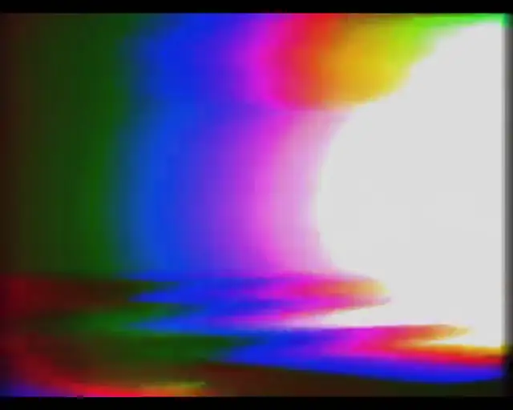 Ridiculous rainbow</a></td>
    <td align="center"><a href="https://videoskillet.com/app/?p=Y5.GIgFEVQA9AEAYA6AAhHAAQBkDEgEkAMIGAKgAgC0AQToAgKcAQH4IQEoAIwBACAAkAMFXGioFAe5vgMAocQB&amp;mod=vFreqHz:smooth:0.08:0.0049,fbGain:smooth:0.24:0.06&amp;src=vhs+static">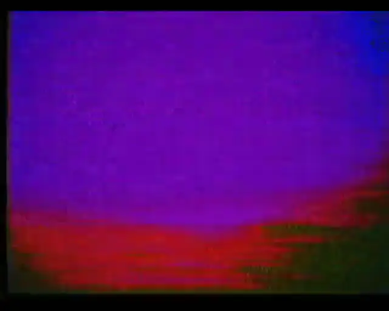 Messed up clouds</a></td>
    <td align="center"><a href="https://videoskillet.com/app/#src=cat&amp;set=chromaGain:2.62,cc:1,ccBox:0.85,ccRomAddr:1,ccRomData:-3,cgMix:0.48,cgY:0.28,cgScale:2.5,cgRomAddr:5,noiseIre:5.9,rfMistuneMHz:0.39,fbMix:0.61,fbZoom:1.028,fbGain:1.096,fbBlack:0.045,cfbMix:1,cfbGain:-1.22,cfbDelayUs:2.357,cfbLines:60,cfbKey:1,cfbKeyLevel:53,cfbKeySoft:10,cfbKeyExt:1,cfbRing:1,cfbGenlock:1,phosphor:0.1603,timeScale:0.45&amp;mod=">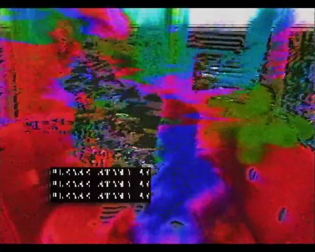 My lord</a></td>
    <td align="center"><a href="https://videoskillet.com/app/#set=capLumaMHz:4.2,demodMHz:3.43,chromaGain:13.62,vir:0.86,lumaMHz:6,noiseIre:9.2,colorUnderMix:0.38,underJitterDeg:1.5,headSwitchNoise:0.15,headSwitchShiftUs:0.3,diffGain:1,diffPhaseDeg:49,tbJitterNs:300,tbWowNs:110,dubGens:3,cfbMix:1,cfbGain:-1.08,cfbDelayUs:2.233,cfbLines:59,cfbKey:0.98,cfbKeyLevel:48,cfbServoUs:0.07,cfbRing:0.89,cfbGenlock:1&amp;mod=&amp;iurlb=https:%2F%2Fthumb.wikimedia.org%2Fwikipedia%2Fcommons%2Fthumb%2Fa%2Fa5%2FMinho_for_Marie_Claire_Magazine_August_Issue_2021_02.png%2F1280px-Minho_for_Marie_Claire_Magazine_August_Issue_2021_02.png%3Futm_source%3Dcommons.wikimedia.org%26utm_campaign%3Dimageinfo%26utm_content%3Dthumbnail&amp;iurl=https:%2F%2Fupload.wikimedia.org%2Fwikipedia%2Fcommons%2Ff%2Ff1%2FJill_St._John_-_Tony_Rome%252C_1967.jpg%3Futm_source%3Dcommons.wikimedia.org%26utm_campaign%3Dimageinfo%26utm_content%3Dthumbnail_unscaled">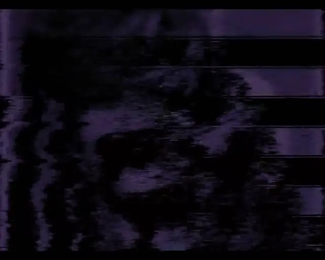 Purplady</a></td>
  </tr>
  <tr>
    <td align="center"><a href="https://videoskillet.com/app/#mod=fbGain:smooth:0.02:0.64&amp;src=vhs+static&amp;set=chromaGain:1.62,hvSagUs:2.1,hvRing:0.61,abl:0.24,lumaMHz:3.2,lumaPeak:2.4,noiseIre:2.5,agc:0.18,colorUnderMix:1,ycDelayNs:420,fmOverdev:0.72,fmStreakUs:0.45,fbMix:0.93,fbRotateDeg:0.11,fbShiftX:-0.003,fbShiftY:0.035,fbIris:0.43,fbVign:0.188604,fbBlack:0.035,fbKnee:1,crtBloom:0.23,cfbMix:0.9,cfbGain:0.56,cfbDelayUs:0.027,cfbKeySoft:16.5,cfbFilterMHz:1,cfbFilterBoost:2.35,cfbRing:1,cfbRingSrc:1,cfbCarrierKHz:0.09,cfbClockPct:-0.02328,cfbGenlock:1,aGain:0.99,phosphor:0.065,crtZoomX:0.7143,crtZoomY:0.314">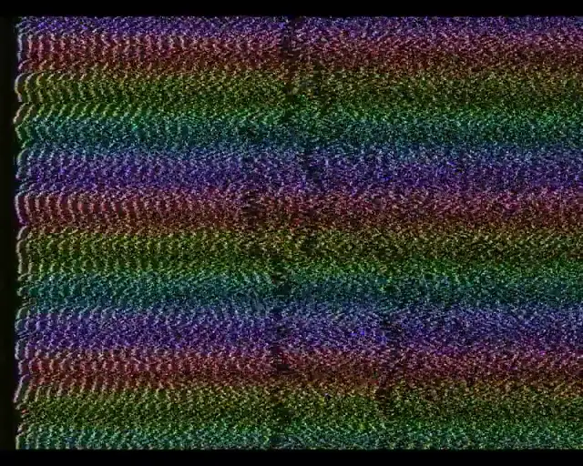 Rainbow snakes</a></td>
    <td align="center"><a href="https://videoskillet.com/app/?p=Nj.FJADAMACAuQDNVAImAIAUALIARaQAwoUAIABANQDApQBAHgARAniAQECCVQk5gMAqAEAqAYAgJ9JA8gB&amp;mod=&amp;srcb=tv+static">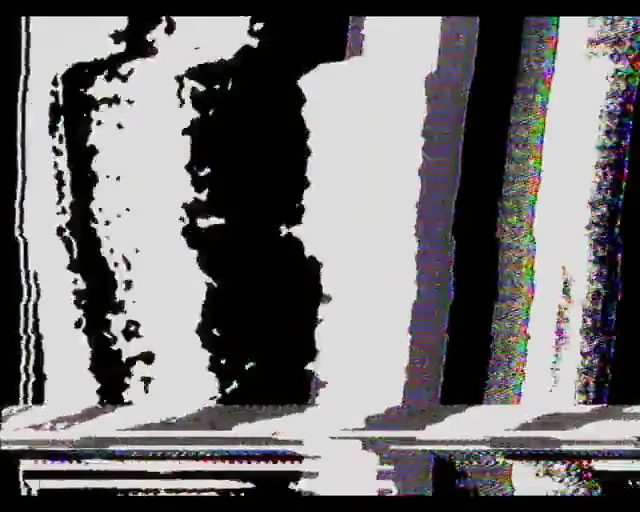 Chaos black and white feedback</a></td>
    <td align="center"><a href="https://videoskillet.com/app/?p=A7.BGgTjAk1NCPEAQCQIACkBgBMAZwhAVwAkAEAHADMARCQAwDQAwDAWwAMAJADANgDAIABAkAA0AEAiAEAwIkBAJADJEAIBCKgnAEfBACgAwCcAQmQAw&amp;mod=&amp;vurl=https://upload.wikimedia.org/wikipedia/commons/6/6b/Gillette_Super-Speed_TV_commercial_with_Pee_Wee_Reese_circa_1956.webm&amp;srcb=tv+static&amp;speeda=0.39">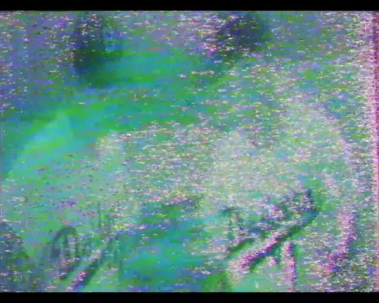 Wonkitize me</a></td>
    <td align="center"><a href="https://videoskillet.com/app/?p=3t.GKwxE4gDRYQDAMQfANADAqwiFZADALgDAJg1AAwAkAMAtAQAfAXQbwC0AiRACAQirGwroAE&amp;mod=&amp;srcb=none">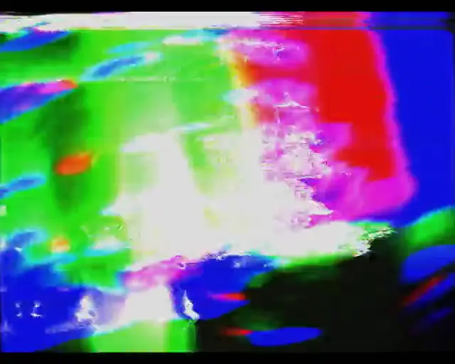 I can't believe it's not analog butter</a></td>
  </tr>
  <tr>
    <td align="center"><a href="https://videoskillet.com/app/?p=je.CoDoBwEEAbAEAKwCAfABAKCZAgXgAw2IIwSIAyFYBrAKEjwGmAEEuB4ZVADsBgr4OiSMCQDEAQDgAgAkAUQEBAAQA9wCAMXBAgCJngIAlf4DAI3tAw&amp;mod=bendUs:lorenz:0.390279:0.27759,hvRing:sine:0.037599:0.090209&amp;srcb=synth&amp;src=sweep">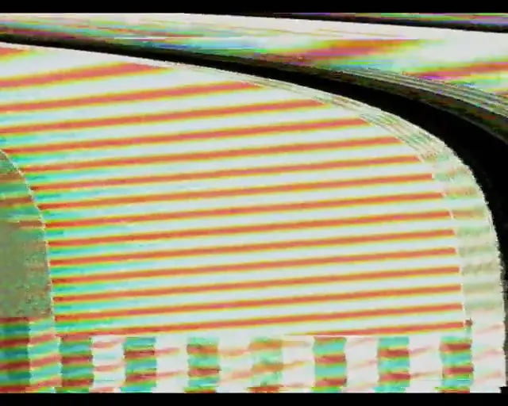 Wiggity</a></td>
    <td align="center"><a href="https://videoskillet.com/app/?p=pa.KsgBFDQOGAGgAQDgAwJ4BvABIaQBBdAMOngsgJMC&amp;mod=&amp;srcb=ia-random&amp;iurl=https:%2F%2Fthumb.wikimedia.org%2Fwikipedia%2Fcommons%2Fthumb%2Fb%2Fb4%2F20250724_mallard_duckling_wethersfield_cove_PD201227.jpg%2F1280px-20250724_mallard_duckling_wethersfield_cove_PD201227.jpg%3Futm_source%3Dcommons.wikimedia.org%26utm_campaign%3Dimageinfo%26utm_content%3Dthumbnail">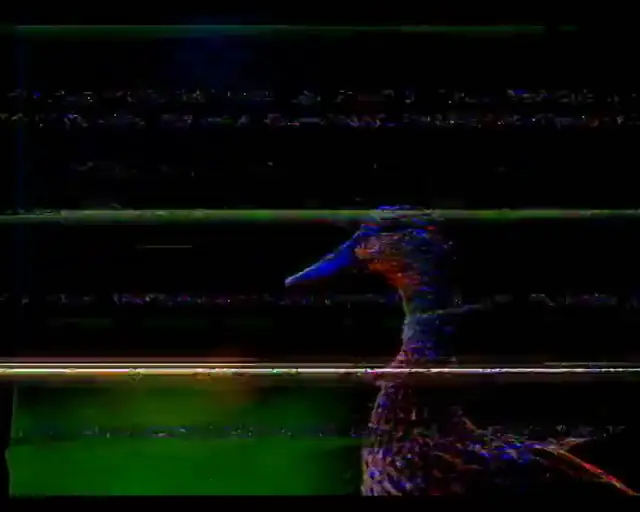 Laser duck</a></td>
    <td align="center"><a href="https://videoskillet.com/app/?p=zD.GNADE4QCRYQDAJgfANYEAvAlAOQBFNwBAdAFL0AIBCKcvgE&amp;mod=&amp;srcb=none">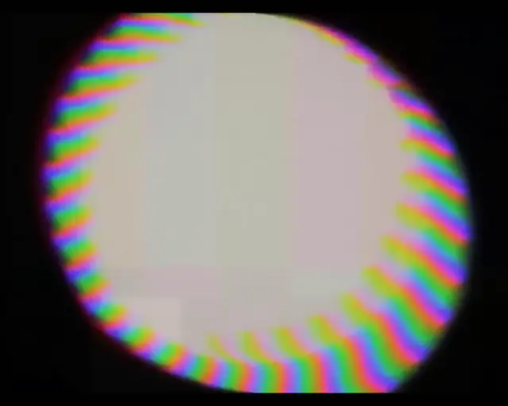 Rainborb</a></td>
    <td align="center"><a href="https://videoskillet.com/app/#set=lumaMHz:2.8,osd:1,osdHoldS:5,osdBlueS:1.5,lumaPeak:0.9,noiseIre:2,colorUnderMix:1,underJitterDeg:4,headSwitchNoise:0.4,headSwitchShiftUs:0.8,tbJitterNs:200,trackAmt:0.1,trackHunt:0.75,trackKick:0.9&amp;mod=">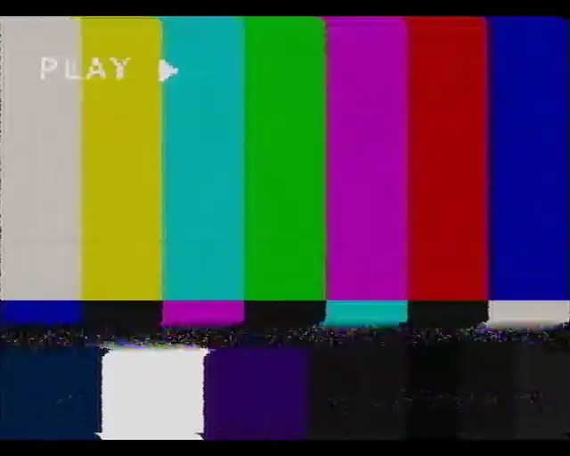 Tape in</a></td>
  </tr>
  <tr>
    <td align="center"><a href="https://videoskillet.com/app/#iurl=https://thumb.wikimedia.org/wikipedia/commons/thumb/d/de/Abandoned_grand_piano_-_Abandoned_Ballroom_%286%29.jpg/1280px-Abandoned_grand_piano_-_Abandoned_Ballroom_%286%29.jpg&amp;vurlb=https://upload.wikimedia.org/wikipedia/commons/transcoded/1/14/HD_video_of_a_Chicken_fillet_roll_-_rotating_green_screen_alan_butler.webm/HD_video_of_a_Chicken_fillet_roll_-_rotating_green_screen_alan_butler.webm.480p.vp9.webm&amp;set=chromaGain:1.3,crtSat:1.2,bGain:1,bGenlock:1,bKey:1,bKeyAcceptDeg:45,bKeyClip:0.05,bKeySpill:0.6,bKeyFill:2,cfbHold:5,bKeyFillHueDeg:30"> Sandwich séance</a></td>
    <td align="center"><a href="https://videoskillet.com/app/#preset=boxInALoop&amp;vurl=https://myloveydove.com/videoskillet/sources/artifacts-fashion-film.webm">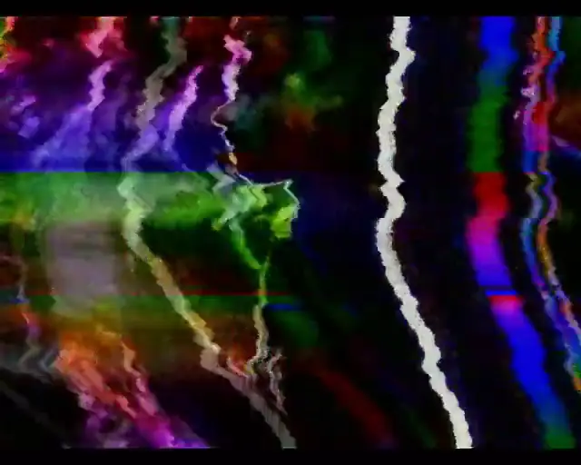 Gatecrasher</a></td>
  </tr>
</table>

## About

Note: this project is extensively vibecoded. The initial signal-path design was
one-shotted by [Fable](https://claude.com/), which nailed the "signal level"
idea behind the glitches. If you use this in your own project(s), I'd appreciate
credit

## License

MIT
