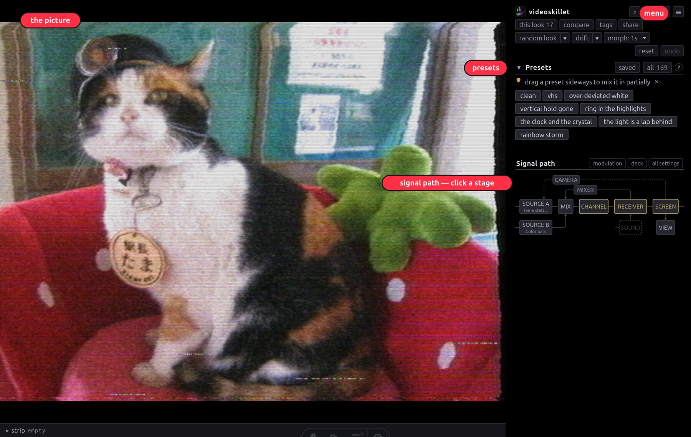

# Getting started

videoskillet simulates the analog video signal in WebGPU shaders. It needs a
browser with WebGPU: current Chrome or Edge, or on Linux, Firefox Nightly or
Chrome with WebGPU enabled. [The FAQ](FAQ.md) lists phones and tablets.

Visit https://videoskillet.com/app/

## The window

**The picture** is on the left. Shift-drag a box across it to zoom in,
double-click to pull back. **The ☰ menu**, top right, holds stills, recording,
fullscreen and settings. **Presets**, below it, is a shortlist of whole looks:
click one and every control it names moves at once.

**Signal path** is the map at the top of the sidebar, and the main thing to
click. Each box is a stage of the chain. Click one and its controls open
underneath. Every control is in there, sources included.

## Three looks to try

|                                                                                          |                                                                                           |                                                                            |
| :--------------------------------------------------------------------------------------: | :---------------------------------------------------------------------------------------: | :------------------------------------------------------------------------: |
|  |  |  |

- **negative** flips polarity on the composite line, and sync goes with it.
- **key sweep** runs the video synth through the chroma keyer.
- **mixer loop** patches the composite into itself past unity, so the loop's
  output builds on itself.

## Where next

- [Features](FEATURES.md): a tour of everything it can break
- [Effects](EFFECTS.md): every control, generated from the app's own table
- [MIDI](MIDI.md): setting up a controller
- [CLI](CLI.md): getting a look onto a file, running locally
- [Agentic AI usage](AI-USAGE.md): letting Claude Code drive the app
- [FAQ](FAQ.md): how it works, what runs it, how a take gets into an edit
