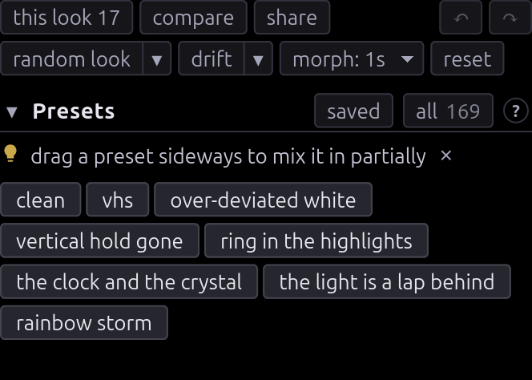
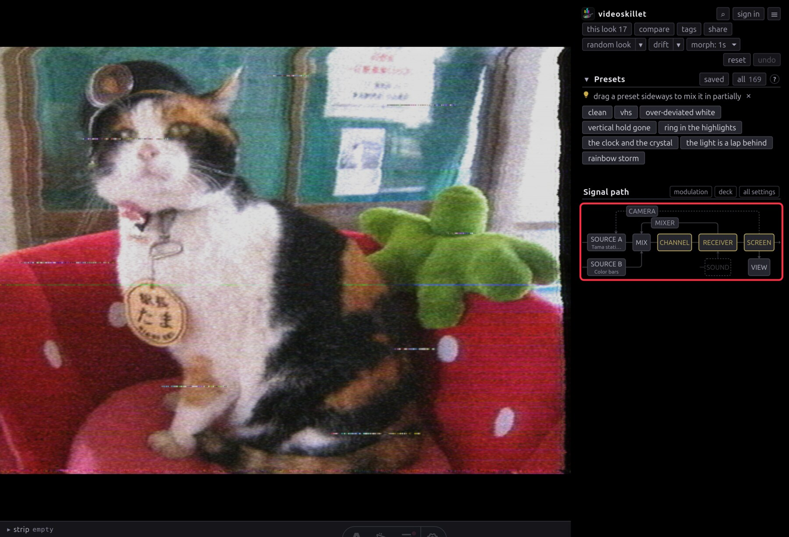
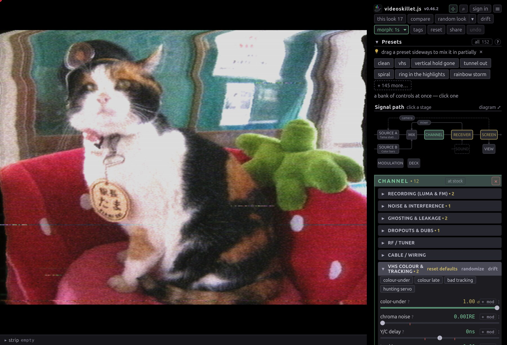
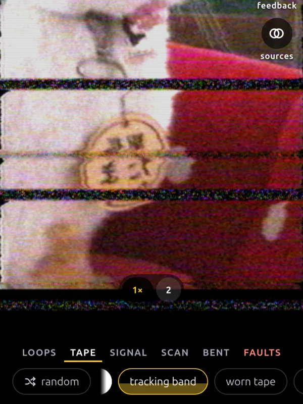
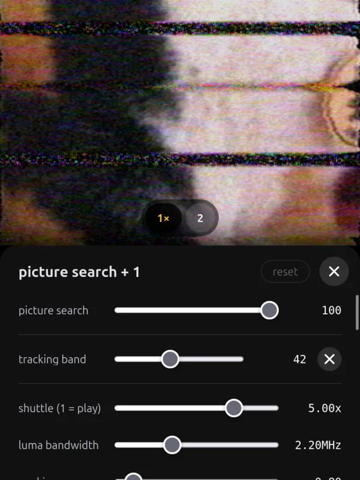
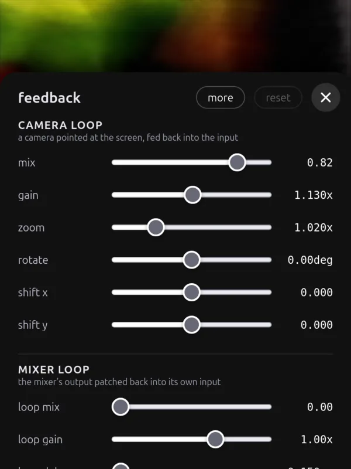
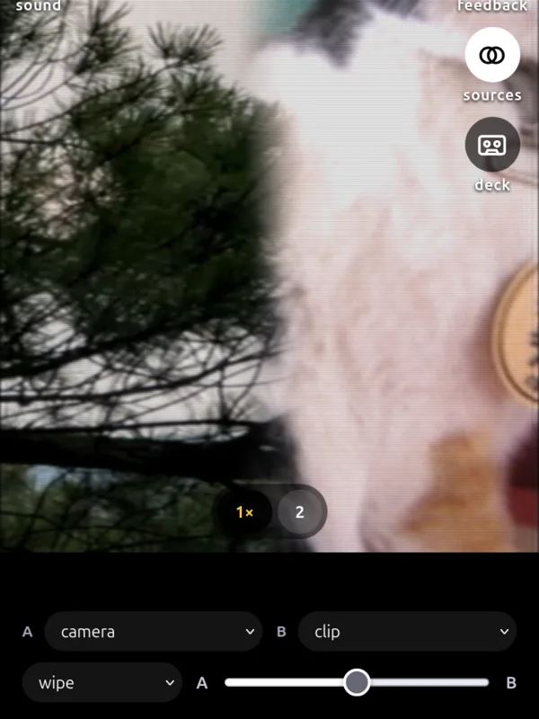
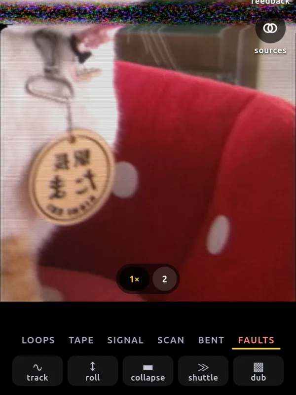

# User guide

Everything past [Getting started](GETTING-STARTED.md).

## Presets and looks

Click a preset to jump to it. Drag it sideways to blend it part-way in.



- **random nudge** keeps your look and moves it a little: everything already
  doing something, plus a few controls that weren't. `shift` for wilder, `alt`
  for gentler, `ctrl`/`cmd` for a wreck. **random look** stacks a few presets
  instead.
- **random motion** leaves every slider where it is and re-patches the
  modulation bay onto controls this look uses. Same modifiers, with `ctrl`/`cmd`
  giving a bay that never settles.
- **drift** runs the random nudge unattended: a gentle nudge every 15 seconds,
  travelling most of the way each time. Every stage heading carries the same
  switch for that stage alone.
- **morph** sets how long a new look takes to arrive: cut, 1s, 4s, 8s or 30s.
  Rolls chain, so rolling every few seconds wanders continuously.

## Sources

Pick each source at the head of its stage: **A** on SOURCE A, **B** on SOURCE B,
sound on SOUND. **A** takes bars, sweep, snow, the bundled photo, a file, a
shared screen or a webcam. B takes the same list plus **Off**, and is
deliberately not genlocked, so it beats and tears against A. Its controls are in
**Mix**.

**Video file URL…** plays an `.mp4` or `.webm` from its address, and needs a
server that allows cross-origin reads; without one the clip plays and the
picture stays black.

The **A pause** slider in Source A freezes the picture while the tape runs on
underneath, with servo damage and a mistrack stripe. **❚❚** stops the tape
itself.

## Working down the chain



The map at the top of the sidebar is the signal path, and every box is a button.
Amber marks a stage you've moved something in. The wires arcing over the trunk
are the feedback loops (camera, mixer), and the chip on each one is that loop's
button.


**at stock**, on the tinted strip carrying a stage's name, holds that one stage
at stock while the rest of the look stays where it is, so you can find which of
several faults is making the artifact.



**?** on any slider explains the fault that control models, and both the filter
box (`/`) and the `ctrl+k` palette search that help text, so you can hunt an
artifact without knowing which knob makes it.

Some rows also carry a **minor** button, which opens a card covering a small
window around the row's current value — ±0.28 µs on **loop delay** and **ghost
delay**, ±100 Hz on **osc A** and **osc B**, ±2 Hz on **vertical osc** — so a
drag there reaches settings the row's track steps straight over.

The loops are the exception to working left to right. They take the picture off
the end and put it back at the front, compounding everything else. Here is a
camera aimed slightly off-axis from its monitor, over a tape dropping out
underneath:

<video
  controls muted loop playsinline
  poster="img/clip-feedback-poster.jpg"
  src="https://cmdcolinphotos.s3.amazonaws.com/phosphene/clip-feedback.mp4"></video>

## Making it move

**+ mod** on a control row patches a slow sine drift onto it and unfolds an
editor where you pick the source and dial the rate and depth. Depth is a
fraction of the control's range, and the slider stays put as the centre the
motion happens around, which is why a preset or a link still holds the look.

**edit in the bay** opens the **MODULATION** box on the map, which has the full
editor under each routing and the tempo at its top. Type or tap a BPM there,
then tie any rate to it with **♩ lock to beat**. MIDI clock takes over whenever
something sends it. See [MIDI.md](MIDI.md).

**stabs** flip the board back to clean in bursts, 60ms by default and anywhere
from 8 to 400, so the look cuts into a clean picture. Phosphor and both feedback
loops keep running through the flip, so a stab leaves a trail.

**Sound** is where audio patches in. Bass lurches the frame and level tears line
hold, so pick something under **♪** first: the mic, a file, the clip already on
screen, or **system audio**, a share of the tab or app this machine is playing
out of. A share arrives silent unless you tick _Also share tab audio_, and not
every browser sends audio through a share at all; Chrome does.

The set's own intercarrier buzz, the picture arriving on the audio line, sits
under that picker and is the one thing in the app that comes out of your
speakers. It starts **silent**, because a preset, a link or a random roll can
raise either of its two level controls — _sound buzz_ under **Channel · Ghosting
& leakage** and _fine tuning_ under **Channel · RF / Tuner**. Switch it to
**buzz out loud** and the app remembers that between visits.

## Playing a piece

The **strip** tray along the bottom of the window is a rundown: a list of looks
the app plays in order. Set the board up, press **+ row**, and do it again. **▶
play** walks the rows from the top, and clicking a card fires only that row.


A row is the session the address bar carries — the look, the modulation bay, the
source and its cue — plus how long it holds and how it arrives, which the chips
along its foot set. **≈4 bars** lands anywhere within a quarter of the count
either way, and **4 bars** with the drift off is the exact lock. Bars come from
the tempo, tapped or off MIDI clock, so a rundown follows the music. Every
random choice a rundown makes draws from the **seed**, which the tray prints.

## Keeping what you find

**saved** is your library, kept on your account, so it needs a sign-in. A recall
brings back the controls and the motion and leaves your input alone. The
[privacy page](https://videoskillet.com/privacy/) lists what the account holds.

### The link carries the look

The address bar carries the whole look at all times — every control off stock,
what is moving in the bay, the source and its cue — so copying it is the share
button and reloading keeps what you had.

A pattern, a text card and a pasted video address go into the link whole, and an
archive clip goes in as its identifier. A clip from your disk or your clip shelf
cannot go in at all, since the reader has neither, so a link made on one opens
on whatever else it names.

Here is **worn tape**, whole:

```
https://videoskillet.com/app/#p=mD.FbQBJbABEXAAmAIN8AEAPAKQAwDoAgCQAwBkAEgBwAIAgAEGwAIA6AIBCA&mod=
```

The app writes the look there as bytes, behind a two-character checksum, and
refuses a link that arrives truncated or with a character changed. `#set=`
spells the same look out by name, and the app reads and writes it too:

```
https://videoskillet.com/app/#set=noiseIre:9,hHold:0.2,chromaGain:1.79
```

The long form lets you program a look by hand: a control name from
[EFFECTS.md](EFFECTS.md), a colon, a number, commas between. The app reads
either sigil, so every one of these also opens spelled `?`.

What the loops have built is in video memory, which the reader's page comes up
with empty, so a link to a board that makes its picture out of the feedback
opens black and stays there. **start it with a burst of snow** in the share box
opens that link on a second and a half of snow for the loops to take hold of.

## Looking closer

Shift-drag a box on the picture to zoom, double-click to reset. The magnifier is
part of the display, so it magnifies the lit tube face too — scan lines, mask
and all.

**signal tap** in the View group steps through the composite waveform, luma,
chroma energy, burst state, the scope, and back. **scope** is the one to try
first. It lays a single line out left to right, sync tip and burst included,
against an IRE graticule, where sync depth, setup, AGC pumping and a burst off
40 IRE are all readable.

## Getting it out

`s` saves a still and `r` records the picture as it plays, with what the
speakers play: the clip's own sound when **♪** is set to video, the reverb, and
the buzz, in stereo. The recording is an H.264 MP4 on a 60 fps grid that lasts
as long as the take did. Where the tab rendered no new frame, the one before it
stays up longer.

**⎙ render** in the strip tray steps the engine on a virtual clock, so the
timing in the file is the simulation's and an editor imports it cleanly. **●
rec** records the hands rather than the picture — every slider, preset,
controller knob and morph, against the frame it happened on — and **⎙** replays
that at 60.

`pnpm render`, with the project running locally, is the one to use when the
colour matters. It writes ProRes 4444, where a browser's 4:2:0 encode loses most
of the dot crawl and rainbow fringing. [CLI](CLI.md) covers it.

**pop out controls** in the ☰ menu moves the panel to a second window, so OBS
can capture the picture window alone.

## Camera

The camera page at `/cam/` puts a phone's camera through the set. A phone
opening the home page gets **Open the camera** as its first button, and its
gallery cards open each demo's board on the camera. **camera** in the ☰ menu
reaches the page from the app.

|                                                                                                                                                                                                                                                                                  |                                                                                                                                                                                                                                                    |                                                                                                                                                                                                                    |
| :------------------------------------------------------------------------------------------------------------------------------------------------------------------------------------------------------------------------------------------------------------------------------: | :------------------------------------------------------------------------------------------------------------------------------------------------------------------------------------------------------------------------------------------------: | :----------------------------------------------------------------------------------------------------------------------------------------------------------------------------------------------------------------: |
|  |  |  |

The tabs sort the looks by which part of the set goes wrong. A tap puts a look
up, and dragging its chip up stacks it on the look that is up, partway. **?** in
the top bar lists the gestures. The page opens on a strong look, picked at
random, with its tab showing; **normal** shows the camera as it comes.

- **random** picks one of four rolls: a new look, a stack of looks, a nudge to
  every knob, or a throw of a few knobs a long way. A nudge or a throw lands as
  tweaks, so **reset** in **tune** takes it back.
- **tune** holds the strength of the look and every control it sets. On a loop
  the strength opens the loop's mix and leaves its gain alone, so the bottom of
  the slider gives echo trails and the top gives the look building on itself.
- In **feedback**, the camera loop builds on itself once **mix** times **gain**
  passes unity. Its sliders spend most of their travel near ×1 and 0, where the
  small moves read best.
- Where the browser exposes the camera's own zoom, a pinch drives the lens and
  crops only past its longest reach. Elsewhere the page crops before the
  encoder, up to 4×.
- **more**, at the top left, holds **tilt**, **on side** and **sound**. A switch
  that is on stays out when **more** closes.
- A look that waits for a hit, such as **power on**, **channel change** or
  **degauss** on the scan tab, shows **tap to fire** over the picture. A tap
  sets it off, and the set recovers on its own.
- **tilt** lets the phone stand in for the feedback camera. A turn fades back
  over a few seconds and never takes a loop past a degree of spin or 2% of shift
  per lap. On a loop with no camera in it, a turn trims the delay, which slides
  the echoes and turns their hue.
- The front camera is mirrored before the encoder, so a ghost still trails to
  the right the way a set draws it.
- A phone held upright shows an upright slice of the glass. **on side** stands
  the whole set on its side, the way an arcade cabinet mounts its tube.
- **sound** lets the room jolt the picture through the set's supply, and
  **VIDEO** then records that sound too.
- The thumbnail beside the shutter opens the share sheet, where **Save Image**
  and **Save Video** put the file in the photo library. A browser with no share
  sheet downloads the file.

### A second picture

|                                                                                                                                                                                              |                                                                                                                                       |
| :------------------------------------------------------------------------------------------------------------------------------------------------------------------------------------------: | :-----------------------------------------------------------------------------------------------------------------------------------: |
|  |  |

**sources** opens the mixer on the left. A clip or one of the set's patterns on
A works with no camera at all.

- **other camera** puts the phone's other camera on B. A phone that cannot run
  both at once gets four seconds of the first camera recorded to a tape and
  looped on B instead.
- **record 4 s** loops four seconds of the camera on B, so the tape plays back
  as an echo of a few seconds ago.
- **sum** adds B in with no sync, so the two beat against each other. A look
  from the **mix** tab works the mixer itself and hides the fader, and picking a
  mode takes the mixer back.

The **faults** tab, on the right, holds the fault pads. A tap on a pad breaks
the picture and heals it. A held pad keeps the picture broken until you let go,
so **roll** keeps rolling for as long as you hold it. With a picture on B, the
fader flips to the other end on the frame where the picture is least legible, so
the cut to the other picture lands inside the fault.

**full app** opens the app on the same preset. The share button beside **?**
sends a link that opens the camera page on the same look, its stack, its knobs
and the pattern on B, or copies the link where the phone has no share sheet.

## Keyboard

| Key                        | Action                                                                                                     |
| -------------------------- | ---------------------------------------------------------------------------------------------------------- |
| `ctrl/⌘+k`                 | command palette                                                                                            |
| `/`                        | filter the controls                                                                                        |
| `c` (hold)                 | preview the clean signal                                                                                   |
| `r` / `s`                  | record a clip / save a still                                                                               |
| `f`                        | fullscreen                                                                                                 |
| `i`                        | cue a clip · press again to loop from there · `+shift` for source B                                        |
| `o`                        | stab back to the cue · `+shift` for source B                                                               |
| `t`                        | strike every one-shot envelope in the bay                                                                  |
| `d`                        | set the whole board drifting · press again to stop where it got to                                         |
| `g` `h` `j` `k` `l` (hold) | track, roll, collapse, shuttle, dub, held until you let go · `+shift` cuts to the other source at the peak |
| `ctrl/⌘+s`                 | save this look to your library                                                                             |
| `1`–`9` / `shift+1`–`9`    | recall / overwrite one of your first nine saves                                                            |
| `ctrl/⌘+z`                 | step back a look · `+shift` or `ctrl/⌘+y` steps forward again                                              |
| `esc`                      | close a dialog, cancel a MIDI arm, clear the filter                                                        |

---

[Features](FEATURES.md): everything it can break · [Effects](EFFECTS.md): every
control · [MIDI](MIDI.md): setting up a controller ·
[How it works](FAQ.md#how-does-it-actually-work): the code
